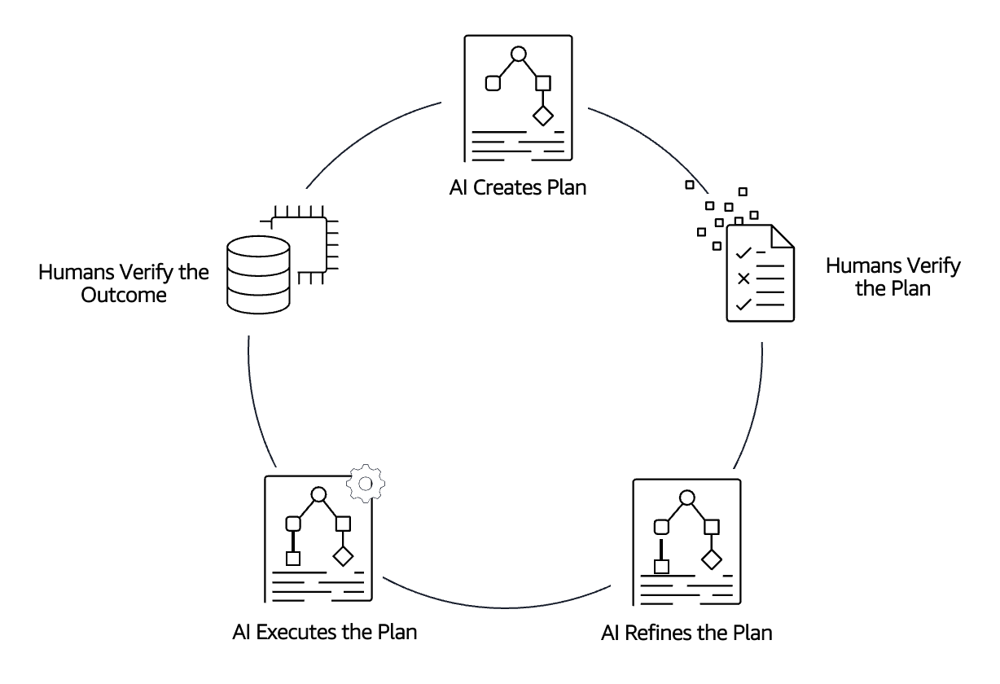
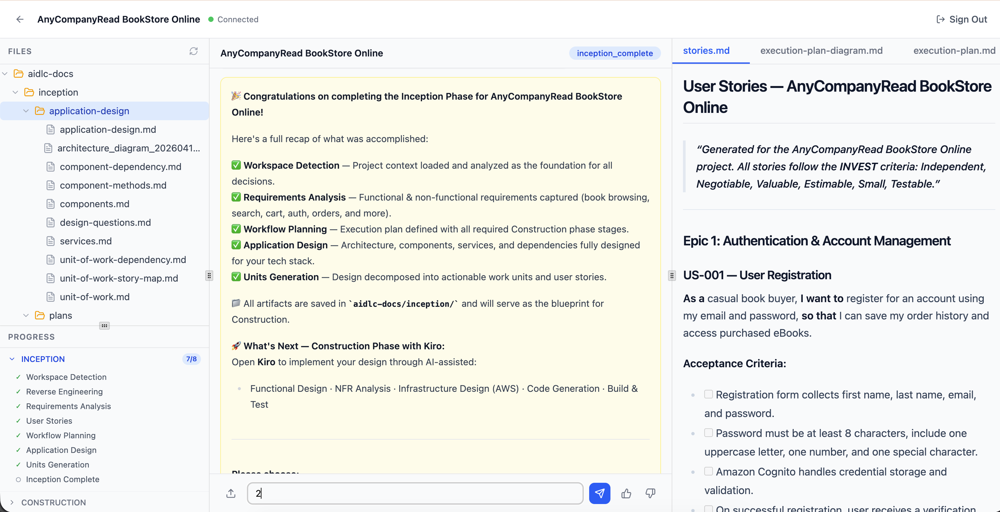

# Agentic SDLC Transformation

A multi-persona, agent-driven collaboration platform for the full software development lifecycle, built on AWS. Six AI-assisted personas work the same project in sequence: a **Business Analyst** uploads requirements and produces user stories; a **Solution Architect** reviews them and produces NFRs, design, and architecture; a **Software Developer** receives the finished design as a downloadable **construction brief**, codes in an AI-assisted IDE, and pushes to GitHub/GitLab; a **QA Engineer** tests the ingested code; and a **DevOps Engineer** plans and releases it — with a read-only **Maintenance Specialist** operations dashboard across it all. The developer's repository is pulled back into the platform (the **Git round-trip**) so QA and DevOps operate on the real code.

The platform runs the **Kiro-native** architecture (see [`.kiro/specs/kiro-native-platform/`](.kiro/specs/kiro-native-platform/)): **Kiro generates every deliverable** (its own agent + model + per-stage Skills), and a **thin serverless backend** — the Project API on **DynamoDB** + **S3** + Cognito — is the authoritative system of record. Users sign in with a persona role, see only the actions their role permits, and pass projects forward through an explicit handoff state machine.

> Looking for step-by-step deployment instructions, login flow, and the BA → SA workflow? See the [User Guide](docs/USER-GUIDE.md).
>
> New to the platform as a user? Start with the [User Documentation guide set](docs/guide/README.md) — overview, architecture, and per-persona walkthroughs.

---

## Table of contents

- [Why is this relevant?](#why-is-this-relevant)
- [Architecture](#architecture)
- [Repository layout](#repository-layout)
- [Prerequisites](#prerequisites)
- [Quick start](#quick-start)
- [Stack outputs](#stack-outputs)
- [Personas and the handoff state machine](#personas-and-the-handoff-state-machine)
- [Tear down](#tear-down)
- [Project structure deep dive](#project-structure-deep-dive)
- [Tests](#tests)
- [Contributing](#contributing)
- [License](#license)

---

## Why is this relevant?

Agentic SDLC Transformation showcases how multiple AI personas can collaborate across the SDLC under explicit human control. It demonstrates how to leverage agentic AI to accelerate software architecture design and development — generating standardized patterns, optimizing configurations, ensuring compliance, and creating documentation — with clear handoffs between roles.

The methodology behind it emphasizes two dimensions:

- **AI-Powered Execution with Human Oversight.** AI systematically creates detailed work plans, actively seeks clarification, and defers critical decisions to humans. Only humans possess the contextual understanding and knowledge of business requirements needed to make informed choices.
- **Dynamic Team Collaboration.** As AI handles routine tasks, teams unite in collaborative spaces for real-time problem-solving and rapid decision-making. The shift from isolated work to high-energy teamwork accelerates innovation and delivery.

<p align="center">
  
</p>

> 💡 For a deep dive on the underlying methodology, see the [AI Driven Development Lifecycle blog post](https://aws.amazon.com/blogs/devops/ai-driven-development-life-cycle/).

**Who is this for?** Product owners, project managers, architects, and engineering leaders who want to reduce the operational burden of a standard development lifecycle and explore how multi-persona agentic AI can accelerate cloud-native software delivery.

---

## Architecture

User interactions flow entirely from **Kiro IDE** (a local MCP server) to a thin serverless backend. **Kiro generates every deliverable** (its own agent + model + per-stage Skills); the backend governs state, RBAC, and validation. Project records, workflow state, the per-project stage cursor, and history live in an **Amazon DynamoDB** table (`AidlcProjects`); artifacts and ingested source live in **Amazon S3**. There is no AgentCore and no web UI.

Key components:

- **Persona/Workflow Registry** — `workflow_registry.json` is the single source of truth for personas, segments, states, the legal handoff transitions, and the per-stage `stage_contracts` (`generator: kiro`, `produces`/`consumes`/`acceptance`/`skill`/`advances_state`). The Kiro MCP server and the Project API both read it; the Project API enforces it.
- **Generation → Kiro** — each persona produces their stage artifacts with Kiro's agent + model, guided by a versioned **stage Skill** (`.kiro/skills/<persona>/<stage>`). There is no server-side stage agent or orchestrator.
- **Project API** — API Gateway + Lambda backed by **DynamoDB** (single-table `AidlcProjects` with GSI1 role-queue / GSI2 broad selection / GSI3 state dashboards). Serves the cross-persona project list, tracks the stage cursor, derives the stage brief, mints owner-gated `produces`-constrained presigned PUTs, runs acceptance validation, and applies handoff transitions atomically (DynamoDB conditional writes → HTTP 409 on a stale write; 403 non-owner; 422 illegal transition).
- **Generation flow** — `get_stage_brief` → generate in Kiro → `submit_artifact` (presigned PUT) → `complete_stage` (validate → advance cursor / apply `advances_state`). Cross-persona ownership transfer is the explicit `handoff_project`; the reviewer bounce is `return_for_changes`.
- **Git round-trip** — `link_repo` + `submit_implementation` triggers a CodeBuild ingestion (clone → `s3 sync` into `{slug}/source/`) that advances to QA; QA `run_tests` triggers a CodeBuild test-runner. All serverless, AgentCore-free.
- **Frontend** — **Kiro IDE** (`code/kiro-mcp/` MCP server + per-persona agents/skills/hooks in `.kiro/`, packaged as the `powers/aidlc-platform/` Power). There is no web UI.
- **Auth** — Amazon Cognito User Pool (per-persona `USER_PASSWORD_AUTH` for the Kiro MCP server). The machine (client-credentials) client and the `agentcore` resource-server scope were removed with AgentCore. The user's persona is selected at sign-up, recorded as the `custom:role` attribute, and assigned to the matching Cognito group by a post-confirmation Lambda trigger.

For the engineering-level architecture, see [`docs/ARCHITECTURE.md`](docs/ARCHITECTURE.md). For more detail, see the [`kiro-native-platform`](.kiro/specs/kiro-native-platform/) spec.

### Frontend: Kiro IDE (the only frontend)

Each persona drives the platform from **Kiro IDE**. A local (stdio) **MCP server** (`code/kiro-mcp/`)
wraps the Project API and the S3 artifact store; one **custom agent per persona** (`.kiro/agents/`),
per-persona **stage Skills** (`.kiro/skills/`), and **enforcement hooks** (`.kiro/hooks/`) ship in the
repo, packaged as the `powers/aidlc-platform/` **Kiro Power**.

The MCP server covers the control plane (list/get/create projects, handoffs, review) **and** the
Kiro-native generation flow (`get_stage_brief` / `submit_artifact` / `complete_stage`). The former
agent-conversation bridge (`run_stage` / `answer_prompt` / the AgentCore WebSocket) has been removed.
Auth is per-persona Cognito (`USER_PASSWORD_AUTH` via a pluggable credential provider); RBAC stays
server-side (Project API 403/422). Enforcement hooks gate review-before-approve and
tests-before-submit but never block a request-changes bounce. See
[`.kiro/specs/kiro-native-platform/`](.kiro/specs/kiro-native-platform/) and
[`code/kiro-mcp/docs/setup.md`](code/kiro-mcp/docs/setup.md). There is no React/web UI.

---

## Repository layout

```
.
├── README.md                       ← this file
├── docs/
│   ├── images/                     ← architecture + portal screenshots
│   └── user-guide.md               ← step-by-step deploy + login + BA→SA walkthrough
├── package.json                    ← root scripts: deploy-infrastructure, delete-infrastructure
├── scripts/
│   ├── package-assets.sh           ← stages and uploads deployment assets to s3://aidlc-assets-…
│   ├── package-code.sh             ← repackages Lambda zips when source changes
│   └── kiro-hooks/                 ← enforcement-hook scripts (review/tests/audit)
├── cdk/                            ← CDK app
│   ├── bin/cdk.ts                  ← entrypoint with the account-mismatch guard
│   ├── lib/
│   │   ├── aidlc-platform.ts       ← top-level stack
│   │   ├── aidlc-platform-auth.ts  ← Cognito User Pool + Kiro USER_PASSWORD_AUTH client + post-confirm trigger + test users
│   │   ├── aidlc-platform-agents.ts← Project API (Lambda + API Gateway) + AidlcProjects DynamoDB table + CodeBuild ingest/test + Git webhook
│   │   ├── aidlc-assetbucket.ts    ← S3 artifact/project bucket
│   │   └── utils/account-guard.ts  ← deploy guard for the pinned account
│   └── custom-resources/           ← Project API (DynamoDB-backed) + post-confirmation Lambda + canonical workflow_registry.json
├── code/
│   └── kiro-mcp/                   ← Kiro MCP server (Python; the only frontend) + its workflow_registry.json copy
└── .kiro/                          ← spec-driven workflow artifacts (agents, skills, hooks, specs, steering)
```

---

## Prerequisites

- **AWS account** with administrator access (for first deploy; production deploys can scope down)
- **AWS CLI v2** configured (`aws configure`)
- **Node.js 20+** with [Yarn](https://classic.yarnpkg.com/lang/en/docs/install/) installed (`npm install -g yarn`)
- **AWS CDK v2** — pinned as a dev dependency; run it via `yarn workspace cdk cdk …` (no global install needed)
- **Docker** — **not required**; the Lambdas bundle from `cdk/custom-resources/` via CDK `Code.fromAsset` (no container build)
- **Kiro IDE** with model access — generation is done by Kiro, so **no server-side Bedrock model access is required by the deployed stack** (only Kiro itself needs model access)

> The CDK app is pinned to a default deployment account via the account-mismatch guard in `cdk/lib/utils/account-guard.ts`. To deploy elsewhere intentionally, pass `-c account=<id>`. See [account guard behavior](#account-guard).

---

## Quick start

The full step-by-step user guide is in [`docs/user-guide.md`](docs/user-guide.md). The minimal happy path is:

```bash
# 1. Clone and install deps
git clone <repo-url>
cd sample-ai-driven-development-lifecycle-platform
yarn install

# 2. Bootstrap CDK (first time per account/region)
yarn workspace cdk cdk bootstrap

# 3. Deploy
yarn deploy-infrastructure
```

`yarn deploy-infrastructure` runs `scripts/package-assets.sh` (which packages and uploads the Lambda zips to `aidlc-assets-<account>-<region>`) and then deploys the `AIDLCPlatformWorkshop` stack via CDK. With the ARM64 agent container build removed (no AgentCore), the deploy is much faster than the old 15–20 minute build.

### Account guard

`cdk/bin/cdk.ts` calls `assertExpectedAccount(resolveAccount(...))` so a deploy targeting an unintended account halts before any resource is created. Precedence: `-c account=<id>` (explicit override, bypasses the guard) > `CDK_DEFAULT_ACCOUNT` (env, gated) > the pinned default. Region defaults to `us-east-1` and is not gated; override with `-c region=<id>` or `CDK_DEFAULT_REGION`.

---

## Stack outputs

When the deploy finishes, the stack prints:

| Output                  | What it is                                                       |
| ----------------------- | ---------------------------------------------------------------- |
| `KiroProjectApiUrl` / `KiroCognitoUserPoolId` / `KiroCognitoClientId` / `KiroFilesBucket` | Config values for the Kiro MCP server (map to `AIDLC_*` env vars — see `code/kiro-mcp/docs/setup.md`). The former `KiroRuntimeArn` output was removed with AgentCore. |
| `BATestUserEmail`       | Pre-provisioned Business Analyst test user email                 |
| `BATestUserPassword`    | Initial password for the BA test user                            |
| `SATestUserEmail`       | Pre-provisioned Solution Architect test user email               |
| `SATestUserPassword`    | Initial password for the SA test user                            |
| `QATestUserEmail`       | Pre-provisioned QA Engineer test user email                      |
| `QATestUserPassword`    | Initial password for the QA test user                            |
| `DevOpsTestUserEmail`   | Pre-provisioned DevOps Engineer test user email                  |
| `DevOpsTestUserPassword`| Initial password for the DevOps test user                        |
| `MaintTestUserEmail`    | Pre-provisioned Maintenance Specialist test user email           |
| `MaintTestUserPassword` | Initial password for the Maintenance Specialist test user        |
| `TestUserEmail`         | Pre-provisioned developer test user email                        |
| `TestUserPassword`      | Initial password for the developer test user                     |
| `AIDLCPlatformAgentsGitWebhookApiEndpoint…` | Public Git push webhook URL (append `git-webhook`) |

All six persona test users are provisioned by a single Lambda-backed custom resource (`<projectName>-test-user-provisioner`) — see [Personas and the handoff state machine](#personas-and-the-handoff-state-machine). For the currently deployed sandbox URL + all six logins, see [`docs/deployed-environment.md`](docs/deployed-environment.md).

Configure the Kiro MCP server with the `Kiro*` stack outputs (see `code/kiro-mcp/docs/setup.md`), open the repo in Kiro as a persona (e.g. the BA), and say "create a new project" or "show me my projects" to begin. Each persona runs their own Kiro window; the Maintenance Specialist is a read-only cross-project viewer.

---

## Personas and the handoff state machine
The platform ships with **six configured personas** — `requirements-analyst` (Business Analyst), `system-architect` (Solution Architect), `software-developer` (Software Developer), `qa-engineer` (QA Engineer), `devops-engineer` (DevOps Engineer), and `maintenance-specialist` (Maintenance Specialist, a read-only dashboard). The first five own workflow segments and hand off in sequence; Maintenance owns no segment. Adding more personas is a registry edit, not a code edit.

### Configured chain (BA → SA → Developer → QA → DevOps)

```text
draft ─► requirements_ready ─► assigned_to_sa ─► in_design ─► design_ready ─► ready_for_dev
  ─► assigned_to_dev ─► implementation_submitted ─► assigned_to_qa ─► in_qa ─► qa_passed
  ─► assigned_to_devops ─► in_deployment ─► deployed   (terminal)

request-changes bounces: SA → BA (assigned_to_sa → requirements_ready) ·
Dev → SA (assigned_to_dev → design_ready) · QA → Dev (in_qa → assigned_to_dev) ·
DevOps → QA (in_deployment → assigned_to_qa)
```

| State | Owning role | What happens |
| --- | --- | --- |
| `draft` | Business Analyst | Project created. BA can upload requirements docs. |
| `requirements_ready` | Business Analyst | Requirements + user stories generated. BA assigns. |
| `assigned_to_sa` | Solution Architect | SA reviews `requirements.md` / `stories.md` / `personas.md` and chooses **Approve** or **Request changes**. |
| `in_design` / `design_ready` | Solution Architect | SA produces **NFR requirements**, **NFR design**, application design, units, and the inception-complete artifacts. |
| `ready_for_dev` | Solution Architect | Design complete. SA hands off to the Developer (**Assign to Software Developer**). |
| `assigned_to_dev` | Software Developer | The `construction_handoff` stage (generated by Kiro) assembles a **construction brief**. The developer codes in Kiro, pushes to GitHub/GitLab, then **links the repo + submits**. May **request design changes** back to the SA. |
| `implementation_submitted` | Software Developer | Repo linked; the ingest CodeBuild clones + syncs the source into S3 and advances to QA. |
| `assigned_to_qa` / `in_qa` / `qa_passed` | QA Engineer | QA reviews test plan/results/report, can **Run tests** (CodeBuild test-runner), and advances or bounces to the developer. |
| `assigned_to_devops` / `in_deployment` | DevOps Engineer | DevOps produces the deployment plan + release runbook; may bounce to QA. |
| `deployed` | DevOps Engineer | Terminal. |

The transitions are enforced by `validate_transition` in the shared registry; the Project API rejects illegal transitions with HTTP 422 and rejects non-owning callers with HTTP 403.

### Maintenance Specialist (operations dashboard)

The `maintenance-specialist` persona is a **read-only operations viewer** — it owns no workflow segment. Signing in as the Maintenance Specialist exposes a **Dashboard** button that opens a cross-project operations view (`/dashboard`, `AdminDashboard`) listing every project with its **assigned persona**, **current stage** (across all six personas), a **Repository** column (ingest status + commit), and per-persona workload/status rollups. It reads the same broad `GET /projects` listing the rest of the UI uses; the dashboard route is gated to the `maintenance-specialist` group.

### The Git round-trip (Developer → QA)

When the SA finishes design (`ready_for_dev`), an **"Assign to Software Developer"** handoff advances the project to `assigned_to_dev` and the **Software Developer** takes over. The `construction_handoff` stage (generated by Kiro) writes a consolidated **construction brief** (`aidlc-docs/construction/construction-brief.md`), which the developer reads in [Kiro](https://kiro.dev) to implement.

The developer then pushes to **GitHub/GitLab** and uses the in-app **link repo + submit** control (optionally supplying a private-repo token, stored in Secrets Manager). Submitting advances the project to `implementation_submitted`, which triggers a **CodeBuild ingestion** job: clone → `s3 sync` the source into the project's `{slug}/source/` prefix → call back to advance the project to `assigned_to_qa`. A **push webhook** (signature-verified) can re-trigger ingestion automatically. From there the **QA** and **DevOps** personas continue the lifecycle in-platform (test planning/execution/report, deployment planning/release), through to the terminal `deployed` state.

<p align="center">
  
</p>

> **Deployed demo environment (URL + all six persona logins):** see [`docs/deployed-environment.md`](docs/deployed-environment.md).

---

## Tear down

```bash
yarn delete-infrastructure
```

> The assets bucket (`aidlc-assets-<account>-<region>`) is created outside the stack, so `cdk destroy` will not remove it. Delete it manually if you no longer need the packaged zips.

---

## Project structure deep dive

The platform preserves a small set of **functional identifiers** that downstream artifacts and tools depend on. These are stable across the rebrand and across persona additions:

| Identifier                          | Where it lives                                |
| ----------------------------------- | --------------------------------------------- |
| Stack name `AIDLCPlatformWorkshop`  | `cdk/bin/cdk.ts`                              |
| Bucket prefix `aidlc-assets-…`      | `scripts/package-assets.sh`                   |
| Artifact prefix `aidlc-docs/`       | Project API, agent Skills, Kiro MCP server    |
| Project Store prefix `_platform/projects/` | `cdk/custom-resources/project_api.py` (reserved; records now in DynamoDB) |
| Secrets path `aidlc/projects/{id}`  | per-project Atlassian + Git credentials       |

If you fork or rebrand, leave these alone — they are the stable interface between the Project API and the Kiro MCP frontend. See [`.kiro/steering/10-stable-identifiers.md`](.kiro/steering/10-stable-identifiers.md) for the identifiers removed with AgentCore (`aidlc-state.md`, `icode-agent`, the gateway tool-name scheme, `KiroRuntimeArn`).

---

## Tests

The repo ships with multiple test suites. Run them all from the repo root:

```bash
# CDK assertion + account-guard tests
yarn workspace cdk test

# Project API + record store + validators + post-confirm + e2e (Python; requires the venv at cdk/custom-resources/.venv-project-api)
# DynamoDB/S3 are exercised against in-memory fakes (tests/fake_dynamodb.py, tests/fake_s3.py) — NOT moto.
cdk/custom-resources/.venv-project-api/bin/python -m pytest cdk/custom-resources/tests/

# Kiro frontend MCP server (Python; the only frontend) — includes the platform tools,
# the multi-persona end-to-end scenario, hook-gating, and agent/skill/Power/steering config tests
code/kiro-mcp/.venv/bin/python -m pytest code/kiro-mcp/tests/
```

The Project API suite (`cdk/custom-resources/tests/`) covers CRUD, conditional-write concurrency (HTTP 409), the GSI2/GSI1 listings, RBAC (403/422), the stage cursor, stage-brief, the `produces`-constrained presigned `stage-artifact-url`, `complete-stage` advance/handoff, the lenient acceptance validators, the `stage_contracts` registry `validate()`, per-segment stage walks, and the full BA → SA → Developer → QA → DevOps lifecycle — all against in-memory fakes (no AWS calls, no moto). The Kiro MCP server suite (`code/kiro-mcp/tests/`) includes `test_tools.py` (the `get_stage_brief` / `submit_artifact` / `complete_stage` flow) and `test_e2e.py`, which replays the multi-persona lifecycle (with a request-changes bounce) against fakes, plus enforcement-hook and config-validation tests.

> The former AgentCore Runtime unit/property suite and the legacy gateway lambda-tools were removed with the AgentCore migration — they are no longer part of the repo or the active deployed path.

---

## Contributing

Contributions are welcome. Open an issue to discuss substantial changes before submitting a pull request.

## License

See [LICENSE](LICENSE).
