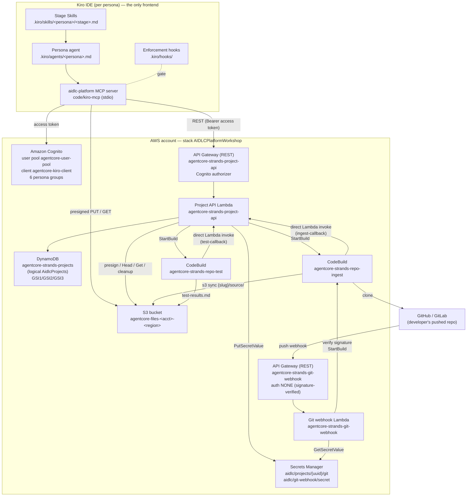
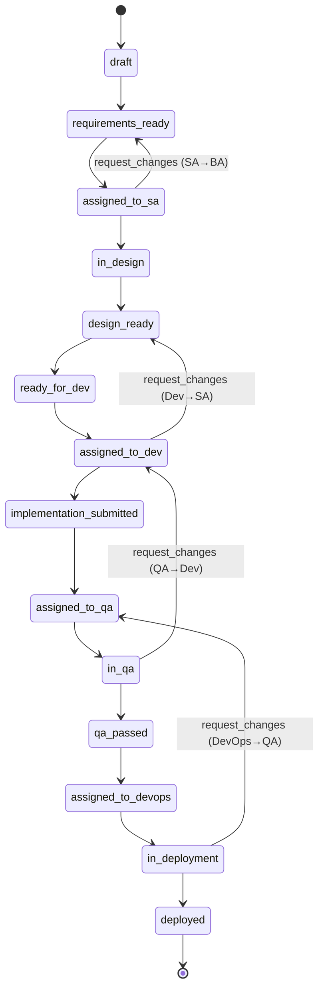

# Architecture — Agentic SDLC Transformation

The platform runs the **Kiro-native** architecture. **Kiro IDE is the
only frontend and generates every deliverable** — each persona produces their
stage artifacts with Kiro's own agent, model, and a per-stage Skill. A **thin
serverless backend (the Project API) is the authoritative system of record**: it
owns workflow state, RBAC, the per-project stage cursor, acceptance validation,
owner-gated artifact submission, and the handoff state machine. The backend runs 
no model and the generation happens entirely in Kiro.

This document is the engineering-level reference for the deployed system. For the
DynamoDB single-table deep-dive see [`architecture/data-model.md`](architecture/data-model.md);
for the interaction traces see [`architecture/sequence-flows.md`](architecture/sequence-flows.md).

---

## 1. System context and component overview

The only network-exposed endpoints are the **Cognito-authorized Project API** and
the **signature-verified Git push webhook**. The ingest/test callbacks are *not*
API Gateway routes — CodeBuild reaches the Project API Lambda by **direct Lambda
invoke** (see [§4](#4-backend-layer-the-project-api)).

### Deployed resources (accurate names)

| Resource | Name |
| --- | --- |
| CloudFormation stack | `AIDLCPlatformWorkshop` |
| Project record store (DynamoDB) | `agentcore-strands-projects` (CDK `ProjectTable`, logical `AidlcProjects`) |
| Project bucket (S3) | `agentcore-files-<account>-<region>` |
| Project API Lambda / REST API | `agentcore-strands-project-api` |
| Repo ingestion (CodeBuild) | `agentcore-strands-repo-ingest` |
| QA test-runner (CodeBuild) | `agentcore-strands-repo-test` |
| Git webhook Lambda / REST API | `agentcore-strands-git-webhook` |
| Cognito user pool | `agentcore-user-pool` |
| Kiro app client | `agentcore-kiro-client` (`USER_PASSWORD_AUTH` + SRP, no secret) |
| Post-confirmation trigger | `agentcore-strands-post-confirmation-role-assign` |
| Test-user provisioner | `agentcore-strands-test-user-provisioner` |

Resource names derive from the deployment config (`cdk/lib/config.ts`,
`projectName: "agentcore-strands"`, `s3.bucketNameAgentPrefix: "agentcore-files"`).
These are deployed-resource identifiers; they are documented as-is and must not be
renamed.

---

## 2. Frontend layer — Kiro IDE

Each persona runs their own Kiro window. Everything the frontend needs ships in
the repo and is packaged as a **Kiro Power** (`powers/aidlc-platform/`):

- **Persona agents** (`.kiro/agents/`): one custom agent per persona —
  `business-analyst`, `solution-architect`, `software-developer`, `qa-engineer`,
  `devops-engineer`, `maintenance-specialist`.
- **Stage Skills** (`.kiro/skills/<persona>/<stage>.md`): the versioned playbook a
  persona follows to generate a stage's deliverable. Every `stage_contract.skill`
  in the workflow registry resolves to one of these files.
- **Enforcement hooks** (`.kiro/hooks/`):
  - `require-review.json` — `PreToolUse` on `complete_stage` / `handoff_project`;
    requires the persona to have reviewed the artifacts first.
  - `require-tests.json` — `PreToolUse` on `submit_implementation`; requires
    passing tests before the developer submits.
  - `audit.json` — `PostToolUse` on state-changing tool calls (audit trail).
  - Hooks gate review-before-approve and tests-before-submit but **never** block a
    `return_for_changes` bounce.
- **MCP server** (`code/kiro-mcp/`, stdio): wraps the Project API + S3 and exposes
  the control plane and generation flow as MCP tools.

### Six personas

| Persona | Cognito group | Segment | Produces |
| --- | --- | --- | --- |
| Business Analyst | `requirements-analyst` | `ba_segment` | requirements, user stories |
| Solution Architect | `system-architect` | `sa_segment` | workflow plan, NFRs, NFR design, application design, units of work |
| Software Developer | `software-developer` | `dev_segment` | construction brief; links repo + submits |
| QA Engineer | `qa-engineer` | `qa_segment` | test plan, test results, QA report |
| DevOps Engineer | `devops-engineer` | `devops_segment` | deployment plan, release runbook |
| Maintenance Specialist | `maintenance-specialist` | *(none — read-only)* | views cross-project dashboards |

The Maintenance Specialist owns no segment; it uses read routes only (the broad
project list and the state dashboard) and can never change state.

### MCP tools

Control plane: `list_projects`, `get_project`, `create_project`,
`upload_requirements`, `list_artifacts`, `get_artifact`, `handoff_project`,
`return_for_changes`, `link_repo`, `submit_implementation`, `run_tests`,
`delete_project`.

Kiro-native generation flow: `get_stage_brief`, `submit_artifact`,
`complete_stage`.

There is no `run_stage` / `answer_prompt` / `advance_project` / `stage_status` /
`close_stage` — the AgentCore agent-conversation bridge was removed.

---

## 3. The Kiro generation flow (brief → generate → submit → complete)

Every active stage is `generator: kiro`. A persona works a stage in four steps:

1. **`get_stage_brief`** — the backend derives the active stage's contract from the
   workflow registry + the project's `current_stage` cursor: its `produces` (each
   with `required` and `acceptance` rules), its `consumes` inputs, and the guiding
   `skill`. Every `produces`/`consumes` path is slug-substituted to a concrete
   per-project S3 key (`{slug}/aidlc-docs/…`). Owner-gated (403 if it is not your
   turn).
2. **generate in Kiro** — the persona reads the `consumes` inputs
   (`get_artifact`) and produces the deliverable using the referenced Skill +
   Kiro's model.
3. **`submit_artifact`** — the backend mints an owner-gated, `produces`-constrained
   short-TTL SigV4 presigned PUT scoped to the exact declared artifact key; Kiro
   uploads the content directly to S3. An off-contract path is rejected (400).
4. **`complete_stage`** — the backend `HeadObject`s each required `produces`
   (a missing/empty **required** artifact is the one hard block →
   `{status: "blocked"}`, no advance), runs acceptance validation over each present
   artifact's content, records the artifact manifest, advances the stage cursor to
   the segment's next stage, and — where the stage declares `advances_state` —
   advances the coarse `handoff_state` within the same owner via
   `validate_transition`. A `HIST#` item is appended atomically.

### Acceptance validation (lenient v1)

Acceptance rules are declared per produced artifact in the registry and evaluated
by `acceptance.py`:

| Rule | Meaning |
| --- | --- |
| `nonempty` | content has non-whitespace text |
| `has_sections:A,B,…` | each named section appears as a markdown heading (case-insensitive, substring match) |
| `min_words:N` | at least N whitespace-delimited words |
| `valid_markdown` | non-empty with balanced fenced code blocks |

Mode is set by `ACCEPTANCE_MODE` (default **lenient**):

- **lenient (v1 default):** rule failures become `warnings[]` and **do not block**
  advancement; the warnings are recorded in the stage-completion history item.
- **strict:** any rule failure blocks advancement.

An **unknown validator** always fails: a warning in lenient mode, fail-closed
(blocking) in strict mode. The **only hard block in lenient mode** is a missing or
empty *required* `produces` artifact — that is decided by the `HeadObject` check in
`complete_stage`, not by the validators.

---

## 4. Backend layer — the Project API

The Project API (`cdk/custom-resources/project_api.py`) is a Python Lambda behind
API Gateway with a Cognito authorizer. It is the sole enforcement point for:

- **RBAC** — server-side owner-gate from the caller's verified `cognito:groups`
  claim. A state-changing action is permitted only when the caller's groups contain
  the record's current `owning_role`.
- **Workflow state** — the coarse `handoff_state` and its `owning_role`.
- **Stage cursor** — the fine-grained `current_stage` within the owning segment.
- **Stage brief derivation** — resolves the active contract from the registry.
- **Acceptance validation** — runs `acceptance.py` at `complete-stage`.
- **Owner-gated artifact submission** — short-TTL, `produces`-constrained presigned
  PUTs.
- **Handoff transitions** — validated through `registry.validate_transition`.
- **Git round-trip orchestration** — link/submit → ingest → callback → QA; run-tests
  → test-runner → callback.

### Route table

All API Gateway routes use the Cognito authorizer (Bearer access token). Owner-gated
routes additionally require the caller's group to equal the record's current
`owning_role`.

| Method | Path | Auth | Owner-gated | Purpose |
| --- | --- | --- | --- | --- |
| POST | `/projects` | Cognito | no | Create a project (client may supply `project_uuid`) |
| GET | `/projects` | Cognito | no | List projects — broad (GSI2), by `role` (GSI1), or by `state` (GSI3); cursor pagination |
| GET | `/projects/{projectId}` | Cognito | no | Read one project record |
| GET | `/projects/{projectId}/stage-brief` | Cognito | yes (owner-read) | Active stage contract (produces/consumes/acceptance/skill) |
| POST | `/projects/{projectId}/stage-artifact-url` | Cognito | yes | Presigned PUT for a declared `produces` artifact (off-contract → 400) |
| POST | `/projects/{projectId}/complete-stage` | Cognito | yes | Validate required produces + acceptance, advance cursor / `advances_state` |
| POST | `/projects/{projectId}/transition` | Cognito | yes | Perform a handoff transition (forward or request-changes) |
| POST | `/projects/{projectId}/reassign` | Cognito | yes | Manual reassignment (same registry rules as transition) |
| POST | `/projects/{projectId}/upload-url` | Cognito | yes | Presigned PUT for an uploaded requirements document |
| POST | `/projects/{projectId}/link-repo` | Cognito | yes | Link a Git repo (SSRF allowlist; optional token → Secrets Manager) |
| POST | `/projects/{projectId}/run-tests` | Cognito | yes | Start the QA CodeBuild test-runner |
| DELETE | `/projects/{projectId}` | Cognito | yes | Delete a project (best-effort artifact cleanup) |
| POST | `/projects/{projectId}/ingest-callback` | **direct Lambda invoke** | n/a (trusted caller) | Ingestion outcome; advances `implementation_submitted → assigned_to_qa` |
| POST | `/projects/{projectId}/test-callback` | **direct Lambda invoke** | n/a (trusted caller) | QA test outcome (`passed`/`failed`); does not change state |

**Callbacks are not API Gateway routes.** The ingest and test CodeBuild jobs
synthesize an API-Gateway-shaped event (`httpMethod`/`resource`/`pathParameters`/
`body`) and reach the handler via `aws lambda invoke` (the build role has
`grantInvoke`). The handler dispatches on the `resource` string. This keeps the
Project API's public surface fully Cognito-gated while letting trusted internal
jobs report outcomes — the IAM invoke grant is the trust anchor.

### Error semantics

| Status | Code | When |
| --- | --- | --- |
| 403 | `FORBIDDEN` | caller is not the current `owning_role` (owner-gate) |
| 409 | `ALREADY_EXISTS` / `ETAG_MISMATCH` | duplicate create, or a stale conditional write (lost update / concurrent handoff) |
| 422 | `ILLEGAL_TRANSITION` | requested transition (or a stage's `advances_state`) is not permitted by the registry |
| 422 | `REPO_NOT_LINKED` | entering `implementation_submitted` without a linked repo |
| 400 | `OFF_CONTRACT_PATH` / `INVALID_REQUEST` / `INVALID_REPO_URL` | off-contract artifact path, malformed request, or disallowed repo URL |

---

## 5. Workflow registry — single source of truth

`workflow_registry.json` is the single source of truth for personas, segments,
states, legal handoff transitions, and the per-stage `stage_contracts`. Personas,
RBAC, workflow segmentation, and status labels all derive from it — nothing is
hardcoded elsewhere.

### Two synchronized copies

With AgentCore removed, the registry lives in **two** places that must stay
consistent (edit one, sync the other in the same change):

1. `cdk/custom-resources/workflow_registry.json` (+ `workflow_registry.py` helper) —
   the Project API Lambda asset. **Canonical.**
2. `code/kiro-mcp/aidlc_mcp/workflow_registry.json` — the Kiro MCP server mirror
   (so the frontend resolves stages/skills without a round-trip).

### Stage contract fields

Each active stage carries a `stage_contract`:

- **`generator`** — `kiro` for every active stage.
- **`skill`** — the `.kiro/skills/<persona>/<stage>` playbook name; every reference
  must resolve to a file.
- **`consumes[]`** — input artifact paths the stage reads.
- **`produces[]`** — outputs, each `{path, required, acceptance[]}`;
  `submit_artifact` is constrained to these paths and `complete_stage` validates
  them.
- **`advances_state`** (optional) — the coarse owned `handoff_state` the stage
  advances to on completion (within the same owner). Stages without it only move the
  `current_stage` cursor.

### Registry helpers and closure

The Project API resolves transitions only through registry helpers:
`forward(state)`, `request_changes(state)`, `validate_transition(current, target)`,
`next_stage(stage)`, `stage_advances_state(stage)`. `validate()` enforces closure:
every `owning_role` exists in `personas`, every state `segment` exists in
`segments`, every `forward`/`request_changes` target is a defined state, the forward
chain from `initial_state` terminates without a cycle, and each `stage_contract` is
well-formed (its `skill` resolves, its stage is in the segment's `stages`, and any
`advances_state` is a legal forward target owned by the segment's role).

### Handoff state machine

Fourteen states from `draft` to `deployed`, with four `request_changes` bounces.

Owning role by state segment: `draft`/`requirements_ready` →
`requirements-analyst`; `assigned_to_sa`…`ready_for_dev` → `system-architect`;
`assigned_to_dev`/`implementation_submitted` → `software-developer`;
`assigned_to_qa`…`qa_passed` → `qa-engineer`; `assigned_to_devops`…`deployed` →
`devops-engineer`.

---

## 6. Git round-trip

The Git round-trip bridges the external coding phase back into the platform, all
serverless and AgentCore-free.

1. **`link_repo`** — the developer links the pushed GitHub/GitLab repo. The URL is
   validated against an SSRF allowlist (`https` to `github.com`/`gitlab.com` with an
   `owner/repo` path only). An optional private-repo token is stored in Secrets
   Manager at `aidlc/projects/{uuid}/git` (never on the record, never logged). This
   records metadata only — it does not advance state or trigger ingestion.
2. **submit** (`submit_implementation` → the `submit` transition) — gated on a
   linked repo (422 `REPO_NOT_LINKED` otherwise). Entering `implementation_submitted`
   triggers the ingest CodeBuild.
3. **ingest CodeBuild** (`agentcore-strands-repo-ingest`) — clones the repo
   (`--depth 1`, optional token), enforces size/file guardrails, `s3 sync`s the
   working tree into `{slug}/source/` (excluding VCS/deps/build trees), captures the
   commit, then invokes `ingest-callback` by direct Lambda invoke.
4. **ingest-callback** — on `ready`, advances `implementation_submitted →
   assigned_to_qa` through the registry (idempotent for late/duplicate callbacks);
   on `failed`, records the reason. QA now owns the project.
5. **QA `run_tests`** — starts the test CodeBuild (`agentcore-strands-repo-test`),
   which pulls `{slug}/source/`, auto-detects and runs the suite (npm / pytest),
   writes `aidlc-docs/qa/test-results.md`, and invokes `test-callback` with
   pass/fail. The callback records the outcome but does not change state — the QA
   Engineer decides whether to advance or bounce.

A **public, signature-verified push webhook** (`agentcore-strands-git-webhook`, on a
dedicated REST API with `authorizationType: NONE`) verifies the GitHub HMAC / GitLab
token against `aidlc/git-webhook/secret`, maps the pushed repo to a project, and
re-triggers the same ingest build.

---

## 7. Security model

- **Authentication** — Amazon Cognito `USER_PASSWORD_AUTH` (plus SRP) per persona
  via the `agentcore-kiro-client` app client (no client secret). The machine
  (client-credentials) M2M client and the `agentcore` resource-server scope were
  removed with AgentCore. Persona is the `custom:role` attribute set at sign-up and
  mapped to a Cognito group by the post-confirmation Lambda trigger.
- **Authorization** — decided **server-side** in the Project API from the caller's
  verified `cognito:groups` claim (the API Gateway Cognito authorizer supplies it
  from the verified JWT, so it cannot be forged). The owner-gate is checked before
  any mutation; there is no client-side or runtime RBAC.
- **Presigned PUTs** — short-TTL (≈300s), SigV4, and constrained to the exact key an
  active stage `produces` (or the `uploaded/` requirements key). A client never
  holds broad S3 write credentials and can never write outside its stage contract.
- **Input handling** — `project_uuid` is regex-constrained to `[A-Za-z0-9_-]{1,256}`
  so it is safe to interpolate into the DynamoDB partition key `PROJECT#{uuid}` and
  can never escape the reserved `_platform/projects/` prefix (path-traversal guard).
  Uploaded filenames reject path separators; repo URLs pass the SSRF allowlist.
- **Secrets** — per-project Git tokens and the webhook secret live in Secrets
  Manager and are never read back, logged, or echoed — referenced by name/ARN only.
- **Least-privilege IAM** — the Project API role is scoped to `{*}/aidlc-docs/*`
  (artifact read/write for presign + acceptance), bucket `ListBucket`,
  `{*}` `DeleteObject` for cleanup (handler-restricted), the per-project git secret
  (`aidlc/projects/*/git-*`), and `StartBuild` on the two named CodeBuild projects.
  The ingest role writes `{*}/source/*`; the test role reads `{*}/source/*` and
  writes `{*}/aidlc-docs/qa/*`.
- **Network exposure** — the only network-exposed endpoints are the
  Cognito-authorized Project API and the signature-verified Git webhook. Any new
  network-exposed endpoint must be authenticated.

---

## 8. Stable identifiers

These are the stable interface between the Project API and the Kiro MCP frontend —
documented as-is; renaming any of them is a breaking change.

| Identifier | Notes |
| --- | --- |
| `aidlc-docs/` | **Stored** artifact prefix (stable S3 key). The MCP server may **display** it as `agentic-sdlc` via a label-only remap; the S3 key is never rewritten. |
| `_platform/projects/` | Reserved object-store prefix. Records live in DynamoDB; the prefix stays reserved so a client `project_uuid` can never collide with a `{slug}/` artifact tree. |
| `aidlc/projects/{id}` | Per-project secrets path (Atlassian / Git credentials). |
| Cognito groups | `requirements-analyst`, `system-architect`, `software-developer`, `qa-engineer`, `devops-engineer`, `maintenance-specialist`. |
| `project_slug` vs `project_uuid` | Kept distinct: the slug is the S3 artifact prefix; the UUID is the DynamoDB partition key and secret-lookup id. |

### What was removed (and why)

The migration off AgentCore removed it and its dependencies:

- **AgentCore Runtime / Gateway / Memory** — Kiro now generates every deliverable;
  there is no server-side generation engine, agent container, or WebSocket bridge.
  The `code/agentcore-runtime/` tree, the gateway tool-name scheme, and the
  `Kiro*RuntimeArn` output are gone (no `AIDLC_RUNTIME_ARN`).
- **Web UI** — no React SPA, no CloudFront, no hosted login / `/config.json`. Kiro
  IDE is the only frontend; the MCP server reads config from CDK stack outputs.
- **Integration Config / Atlassian proxy and VPC** — not part of the active
  architecture.

---

## 9. Cross-links

- [`architecture/data-model.md`](architecture/data-model.md) — DynamoDB single-table
  design, item shapes, access-pattern table, optimistic concurrency.
- [`architecture/sequence-flows.md`](architecture/sequence-flows.md) — Mermaid
  sequence diagrams for generation, handoff, Git round-trip, and QA tests.
- [`architecture/README.md`](architecture/README.md) — index of the architecture
  set.
- [`deployment-steps.md`](deployment-steps.md) — deploy walkthrough.
- [`../code/kiro-mcp/docs/setup.md`](../code/kiro-mcp/docs/setup.md) — Kiro MCP
  server setup and env-var mapping from stack outputs.
- [`../.kiro/specs/kiro-native-platform/`](../.kiro/specs/kiro-native-platform/) —
  the kiro-native-platform requirements + design spec.
