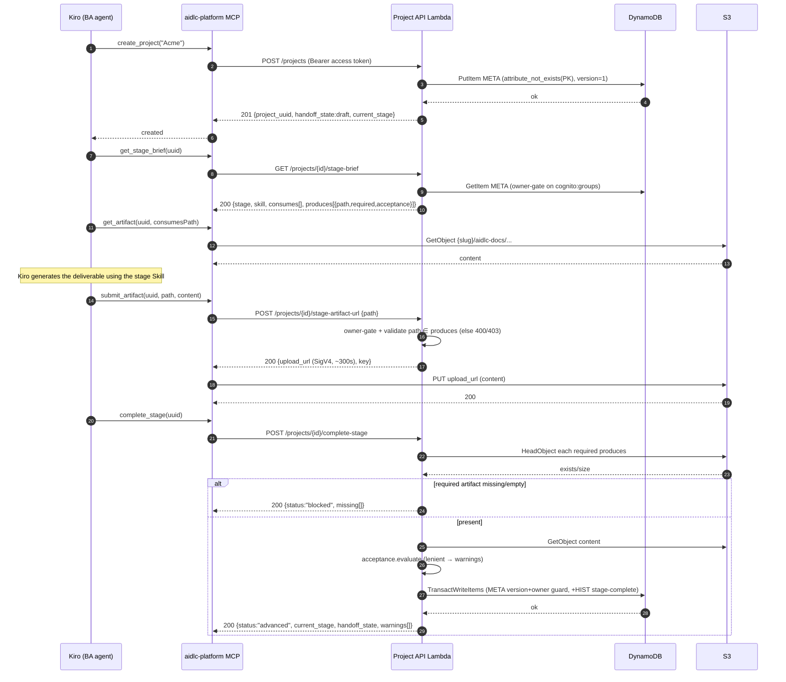
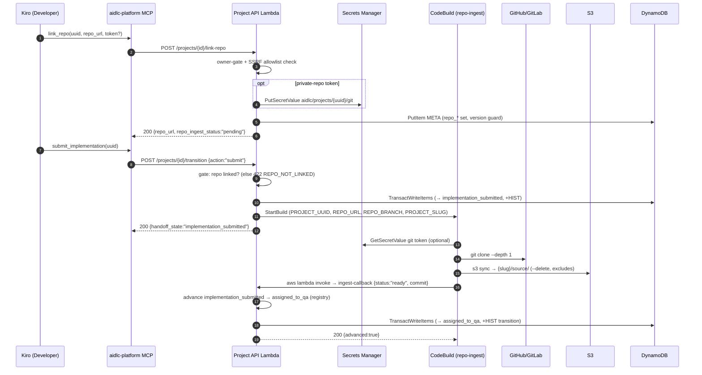
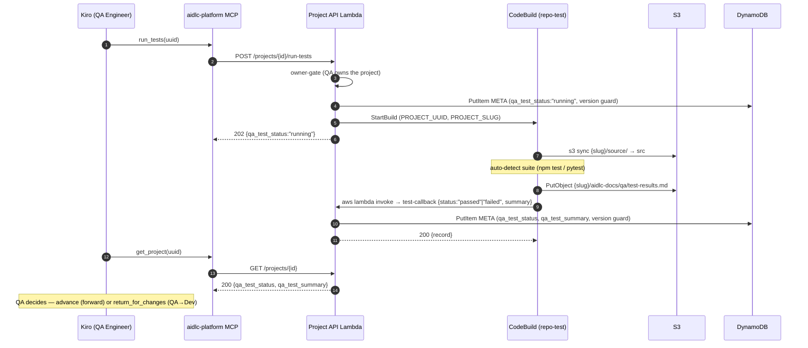

# Sequence flows

Interaction traces for the platform. Participants are accurate to the
deployed system: the Kiro persona agent, the `aidlc-platform` MCP server, the
Project API Lambda, DynamoDB, S3, CodeBuild, and Cognito. See
[`../ARCHITECTURE.md`](../ARCHITECTURE.md) for the component overview and
[`data-model.md`](data-model.md) for the item shapes.

---

## (a) Create a project and generate a stage (BA)

The Kiro-native generation flow: `get_stage_brief` → read inputs →
`submit_artifact` (presigned PUT) → `complete_stage` (validate → advance).



---

## (b) Cross-persona handoff and reviewer bounce

`handoff_project` transfers ownership to the next persona; `return_for_changes` is
the reviewer bounce. Both are thin wrappers over the authoritative `transition`
route (the MCP layer never re-decides legality).

```mermaid
sequenceDiagram
    autonumber
    participant P as Kiro (owning persona)
    participant MCP as aidlc-platform MCP
    participant API as Project API Lambda
    participant DDB as DynamoDB

    Note over P,API: Handoff (forward)
    P->>MCP: handoff_project(uuid)
    MCP->>API: POST /projects/{id}/transition {action:"advance"}
    API->>DDB: GetItem META
    API->>API: owner-gate; validate_transition(current, forward)
    alt permitted
        API->>DDB: TransactWriteItems (META→new state/owner, +HIST transition)
        API-->>MCP: 200 {handoff_state, owning_role}
    else illegal
        API-->>MCP: 422 ILLEGAL_TRANSITION (unchanged)
    end
    MCP-->>P: handed off to next persona

    Note over P,API: Reviewer bounce (never blocked by hooks)
    P->>MCP: return_for_changes(uuid, comments)
    MCP->>API: POST /projects/{id}/transition {action:"request-changes", note}
    API->>API: request_changes(current).target; owner-gate
    API->>DDB: TransactWriteItems (META→bounce target, +HIST transition)
    API-->>MCP: 200 {handoff_state (bounced back)}
    MCP-->>P: returned for changes
```

On a stale write (concurrent modification / ownership change) the transaction is
cancelled and the API returns **409 `ETAG_MISMATCH`**.

---

## (c) Git round-trip (link → submit → ingest → advance to QA)



A public, signature-verified push webhook (`agentcore-strands-git-webhook`) can
re-trigger the same ingest build after verifying the GitHub HMAC / GitLab token
against `aidlc/git-webhook/secret`.

---

## (d) QA test-runner (run_tests → CodeBuild → test-callback)



The `test-callback` records the outcome only; it never changes `handoff_state`. The
QA Engineer decides whether to advance or bounce the project back to the developer.
